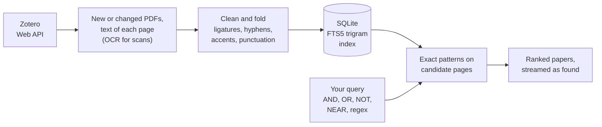

<p align="center">
  
</p>

<p align="center">
  <b>Search inside every PDF of your Zotero library, and land on the right page.</b>
</p>

<p align="center">
  <a href="https://pypi.org/project/zotegrep/"></a>
  <a href="https://pypi.org/project/zotegrep/"></a>
  <a href="https://github.com/marcpinet/zotegrep/actions/workflows/ci.yml"></a>
  
  
  
  <a href="LICENSE"></a>
</p>

<picture>
  <source media="(prefers-color-scheme: dark)" srcset="https://raw.githubusercontent.com/marcpinet/zotegrep/main/docs/screenshot-dark.jpg">
  
</picture>

## Why

Zotero's search tells you *which* items match. ZoteGrep shows *where*: every occurrence across the whole library,
with its sentence and page number, and one click opens the PDF on that page with the match selected. It also
understands what a literature search needs: phrases, exclusions, two words close to each other, regular
expressions, and your own notes and annotations.

It runs on your computer, from the terminal or in your browser. Your PDFs and your index never leave it: the only
server ZoteGrep talks to is the Zotero API.

## Install

```bash
pipx install zotegrep        # or: pip install zotegrep
```

Python 3.10 or newer, on Linux, macOS or Windows. For scanned PDFs, install
[Tesseract](https://tesseract-ocr.github.io/tessdoc/Installation.html) too (`apt install tesseract-ocr`,
`brew install tesseract`, or the Windows installer): ZoteGrep finds it on its own and reads those pages with OCR.

## Quick start

You need your Zotero **user ID** and an **API key** with read access, both on
[zotero.org/settings/security](https://www.zotero.org/settings/security#applications).

```bash
zotegrep library add 1234567 --key <your API key>   # --group for a group library (its ID is in its URL)
zotegrep sync                                       # download the PDFs and index every page
zotegrep search 'point adjust NEAR/5 F1'            # search from the terminal
zotegrep serve                                      # or in the browser, at http://localhost:21824
```

```text
Position: Quo Vadis, Unsupervised Time Series Anomaly Detection?  7 matches
  2024 · Sarfraz, M. et al. · arXiv
      p. 1  ...Although using the standard F1 score without point-adjust avoids those pitfalls, it still...
      p. 5  ...we also include the flawed and commonly used F1 score with point adjustment denoted as F1PA...
  key 3XQ8ZK2M · 5 more · zotero://select/library/items/7HN4CW9T

An Evaluation of Anomaly Detection and Diagnosis in Multivariate Time Series  7 matches
  2022 · Garg, A. et al. · IEEE Transactions on Neural Networks and Learning Systems
      p. 3  ...we find that a popular metric, point-adjusted F1 score [8], [10], [17] gives a close to...
```

The web interface does the same, plus library settings, so you can also start with `zotegrep serve` and add
your library from its **Settings** button.

## What you can type

| You type | You get |
| --- | --- |
| `time series` | *time series*, *time-series*, *timeseries*, *Time Series*; accents, curly quotes and dashes don't matter |
| `anomaly, transformer` | both, in the same paper, page or paragraph (you pick the scope) |
| `mamba OR s4` | either one |
| `anomaly, -forecasting` | papers about anomalies that never mention forecasting (`NOT` works too) |
| `"RAG"` | the exact word or phrase: *RAG*, not *fragment* |
| `point adjust NEAR/5 F1` | both within 5 words of each other, in any order |
| regex mode (`-E`, or `.*` in the browser) | the whole query is one regular expression |

The search covers the PDF text, titles, authors, abstracts, and your Zotero notes and annotations. It can be
narrowed to a library, a collection (subcollections included), tags, years or an author; with no query, these
filters simply list the matching papers.

## In the browser

<p align="center">
  <picture>
    <source media="(prefers-color-scheme: dark)" srcset="https://raw.githubusercontent.com/marcpinet/zotegrep/main/docs/viewer-dark.jpg">
    
  </picture>
</p>

- **Every match, in context.** Papers come with their first snippets and page numbers; a side panel shows the
  abstract and all the matches. Clicking a snippet opens the built-in PDF viewer on that page.
- **Filters that mirror Zotero.** Collection tree, tags in their Zotero colors, years, authors, several libraries.
- **Back to Zotero in one click.** Open the item in the desktop app or on zotero.org, copy its APA citation or its
  BibTeX (generated by Zotero), follow its DOI.
- Results stream in as they are found, shareable URLs, keyboard navigation (<kbd>Ctrl</kbd> <kbd>K</kbd>,
  arrows, <kbd>Enter</kbd>), light and dark themes, works on a phone. While `zotegrep serve` runs, it syncs
  with Zotero every 10 minutes (configurable).

## In the terminal

| Command | What it does |
| --- | --- |
| `zotegrep library add ID [--group] [--key KEY] [--name NAME]` | add a library (the key is asked for if omitted) |
| `zotegrep library list` · `edit ID` · `remove ID` | list, rename or re-key, remove (with its local data) |
| `zotegrep sync` | download new or changed PDFs and index them; <kbd>Ctrl</kbd> <kbd>C</kbd> stops cleanly |
| `zotegrep search QUERY` | search: `--scope page`, `--collection`, `--tag`, `--since`, `--until`, `--author`, `-c` case, `-E` regex, `--sort`, `-n` papers, `-s` snippets |
| `zotegrep search QUERY -l` · `--json` | only the matching papers, or one JSON object per paper for scripts |
| `zotegrep serve [--port N] [--no-browser]` | the web interface |
| `zotegrep status` | where things are, what is indexed, whether OCR is available |

Like `grep`, `zotegrep search` exits with 0 when something matched, 1 when nothing did, 2 on error.

## How it works



Matching works like `grep`, on substrings: the trigram index only narrows the search to the pages that can contain
every term. The patterns run on a folded copy of each page that has exactly the same length as the original, so
every match maps back to the very characters shown in the snippet and in the PDF. Relevance counts matches per page
with diminishing returns, weighs rare terms more and doubles title matches, so a 200-page thesis does not bury a
10-page paper about exactly your topic. On a Raspberry Pi, a search across 234 papers (4,868 pages) takes 0.2 to
0.8 s.

The sync only downloads new or changed PDFs, does not list the library again while its version stays the same,
indexes duplicate files once, and simply retries later a PDF that Zotero has not uploaded yet. The PDFs must be
stored on zotero.org (Zotero Storage): the Web API cannot reach linked files or WebDAV.

## Configuration

Everything lives in two places, shown by `zotegrep status`: a `config.json` file (libraries, API keys, sync
interval) in your user configuration folder, and a data folder with the SQLite index and the downloaded PDFs.
Setting `ZOTEGREP_HOME`, or passing `--home DIR`, keeps both under one directory instead.

| Variable | Purpose |
| --- | --- |
| `ZOTEGREP_HOME` | one directory for the configuration and the data |
| `ZOTEGREP_OCR_LANGUAGES` | Tesseract languages, e.g. `eng+deu` (default: English and French when installed) |
| `TESSDATA_PREFIX` | where Tesseract's language data is, if it is not found automatically |

**Security.** There are no accounts: the web interface listens on `127.0.0.1` only, refuses requests whose `Host`
is not this machine (DNS rebinding) and writes coming from other websites. API keys never reach the browser, and
the configuration file is readable by your user only. `zotegrep serve --host 0.0.0.0` opens it to your network,
with a warning, since anyone who reaches it can use it.

## Development

```bash
git clone https://github.com/marcpinet/zotegrep && cd zotegrep
python -m venv .venv && .venv/bin/pip install -e ".[test]"      # Windows: .venv\Scripts\pip
.venv/bin/pytest
```

The tests run offline in a few seconds: a fake Zotero client and generated PDFs exercise the sync, the search, the
web API and the command line. To release, bump `__version__` in `src/zotegrep/__init__.py` and push to `main`: the
[`pypi.yml`](.github/workflows/pypi.yml) workflow builds the package, tests the wheel, publishes it to PyPI and
creates the matching GitHub release.

```text
src/zotegrep/
  cli.py       command line
  web.py       local web server and JSON API
  search.py    query language, FTS5 preselection, matching, relevance
  sync.py      Zotero sync: metadata, PDFs, collections, notes and annotations
  store.py     SQLite schema and queries
  text.py      PDF text extraction, OCR, normalization
  config.py    configuration file and paths
  static/      web interface, PDF viewer (PDF.js), fonts (IBM Plex)
```

## License

[AGPL-3.0-or-later](LICENSE). Bundled: [PDF.js](https://github.com/mozilla/pdf.js) (Apache-2.0) and the
[IBM Plex](https://github.com/IBM/plex) fonts (SIL Open Font License 1.1).
